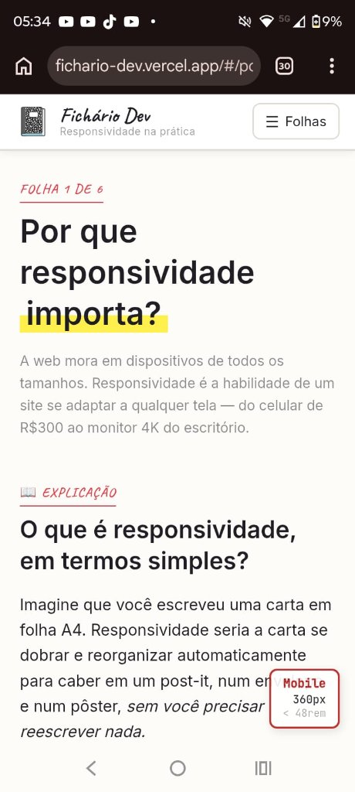

# 📓 Fichário Dev — Guia Interativo de Responsividade e Boas Práticas em Vue 3

> Projeto desenvolvido para a disciplina de Desenvolvimento Web / Front-end.  
> Uma aplicação web interativa em Vue 3 que orienta a criar páginas fluidas, adaptáveis e com performance que funcionam em qualquer tela — do celular de entrada ao monitor ultrawide.

---

## 👥 Integrantes da Dupla

- **Integrante 1:** Kauan Alejandro da Rosa
- **Integrante 2:** Renan Ramos Capeleti

---

## 🔗 Links Importantes

- **Site Publicado:** [https://fichario-dev.vercel.app/#/por-que-importa](https://fichario-dev.vercel.app/#/por-que-importa)
- **Repositório GitHub:** [https://github.com/wxpett/fichario-dev](https://github.com/wxpett/fichario-dev)
- **Captura de Tela no Celular:** [`docs/screenshots/celular-dupla.jpg`](./docs/screenshots/celular-dupla.jpg) (veja a demonstração abaixo)

---

## 📱 Captura de Tela no Aparelho Celular da Dupla

<div align="center">
  
  <p><em>Site publicado na Vercel rodando em dispositivo móvel real (viewport 360px, breakpoint Mobile ativo).</em></p>
</div>

---

## 🎨 Identidade Visual Original: "O Caderno Universitário"

Para fugir da estética genérica e padronizada de interfaces geradas por IA, o **Fichário Dev** adota a metáfora tátil de um **caderno universitário / fichário de argolas**:
- Folhas de fichário numeradas (Folhas 1 a 6) com grade pontilhada (*dot-grid* em CSS puro) e linha de margem vermelha.
- Tipografia orgânica inspirada em anotações manuais (*Caveat*) combinada com fonte técnica (*JetBrains Mono*) e corpo legível (*Inter*).
- Post-its coloridos ligeiramente inclinados para perguntas e reflexões.
- Efeito de marca-texto amarelo nos tópicos-chave.
- Carimbos circulares verdes de *"Lida!"* com estado persistente no LocalStorage via **Pinia**.
- No celular, as abas de navegação colapsam em um botão hambúrguer acessível.

---

## 🔬 Laboratórios Interativos Implementados (5 Labs)

O projeto cumpre com folga a exigência mínima de 3 laboratórios, oferecendo **5 demonstrações práticas**:

1. **Monitor Fixo de Breakpoint e Largura (Global):**
   - Um badge fixo no canto inferior direito que exibe a largura exata da janela em pixels e o breakpoint ativo (*Mobile*, *Tablet*, *Desktop*), sincronizado via Pinia e evento de redimensionamento (`resize`).
2. **Caneta Azul vs. Caneta Vermelha (Folha 2 — Unidades CSS):**
   - Controle dinâmico para simular a mudança do `font-size` raiz do navegador (16px a 32px), demonstrando visualmente como o `rem` se adapta às preferências de acessibilidade enquanto o `px` permanece travado.
   - **Conversor bidirecional de unidades** (`rem`, `em`, `%`, `px`).
3. **Régua de Esticar do Grid Auto-Responsivo (Folha 3 — Flexbox & Grid):**
   - Slider interativo de 280px a 800px para ver quando o contêiner passa de 1 para 2 colunas (**em 464px**) e para 3 colunas (**em 704px**), calculando e exibindo a fórmula CSS em tempo real.
4. **Foto Polaroid com Atraso de Rede e Consumo de API (Folha 4 — Imagens Responsivas):**
   - Demonstração prática do **CLS (Cumulative Layout Shift)** ao carregar imagens assíncronas via API Picsum com atraso de rede. Permite alternar a reserva de espaço (`width` e `height` no HTML / `aspect-ratio`) e observar o texto "pulando" vs. layout estável.
5. **Bug do `v-for` sem `:key` ao Vivo (Folha 5 — Boas Práticas Vue):**
   - Comparação lado a lado entre listas com e sem `:key`. Demonstra o problema de reutilização de nós do DOM (*patch in-place*), onde o texto digitado em um input permanece no elemento incorreto ao remover o primeiro item da lista.

---

## 📚 Conteúdo Obrigatório e Respostas às Perguntas-Guia

### Folha 1 — Por que responsividade importa?
- **Explicação:** Conceito de layout fluido, a tríade viewport + unidades relativas + media queries, e estatísticas de uso mobile.
- **Pergunta-Guia 1:** *Um site tem media queries bem escritas, mas não tem a meta tag viewport. No celular, ele aparece como a versão de computador, só que minúscula. Por que isso acontece, e o que a meta viewport muda?*
  - **Resposta:** Sem a meta viewport, dispositivos móveis usam um "viewport virtual" de ~980px (legado dos anos 2000) e encolhem a página inteira para caber na tela física. As media queries nunca disparam porque o navegador acredita estar em uma tela de 980px. A tag `<meta name="viewport" content="width=device-width, initial-scale=1.0">` força o navegador a utilizar a largura física real do aparelho (ex: 390px), ativando as media queries mobile.

### Folha 2 — Unidades CSS
- **Explicação:** Diferenças entre unidades absolutas (`px`) e relativas (`rem`, `em`, `%`, `fr`, `vw`, `vh`, `dvh`, `ch`), e quando aplicar cada uma.
- **Pergunta-Guia 2:** *Uma pessoa com baixa visão aumenta o tamanho da fonte nas configurações do navegador. O texto definido em px continua do mesmo tamanho, e o definido em rem aumenta. Por que essa diferença acontece?*
  - **Resposta:** O navegador possui um tamanho de fonte base (`font-size` raiz do elemento `<html>`), tipicamente 16px. A unidade `rem` é proporcional a essa raiz: se o usuário altera a configuração para 20px ou 24px, todo texto em `rem` escala automaticamente. O pixel (`px`), sendo unidade absoluta, ignora o tamanho da raiz e bloqueia as configurações de acessibilidade do usuário.

### Folha 3 — Flexbox e Grid
- **Explicação:** 1D (Flexbox) vs. 2D (Grid), propriedades principais (`justify-content`, `align-items`, `flex-wrap`, `gap`) e padrões auto-responsivos com `repeat(auto-fit, minmax(...))`.
- **Pergunta-Guia 3:** *Um contêiner usa `grid-template-columns: repeat(auto-fit, minmax(14rem, 1fr))` e `gap: 1rem`. A partir de qual largura do contêiner, em px, os cards deixam de ficar em 1 coluna e passam para 2? Considerem 1rem = 16px e mostrem a conta.*
  - **Resposta:** Para acomodar 2 colunas, o contêiner precisa de espaço para duas larguras mínimas mais um espaçamento (gap):  
    $$\text{Largura} = 14\text{rem} + 1\text{rem (gap)} + 14\text{rem} = 29\text{rem}$$  
    $$29\text{rem} \times 16\text{px} = \mathbf{464\text{px}}$$  
    Portanto, a partir de **464px**, o Grid quebra automaticamente para 2 colunas sem necessidade de media query.

### Folha 4 — Imagens Responsivas
- **Explicação:** `max-width: 100%`, `height: auto`, dimensões no HTML, `loading="lazy"` e quando **não** usar, `aspect-ratio`, `object-fit: cover` e atributos `srcset`/`sizes`.
- **Pergunta-Guia 4:** *Ao abrir uma página, o texto aparece primeiro. Quando a imagem termina de carregar, ela empurra o texto para baixo. Por que isso acontece quando a imagem não tem width e height no HTML? Qual métrica do Google mede esse problema?*
  - **Resposta:** Sem `width` e `height` definidos no HTML, o navegador aloca inicialmente 0px de altura até que a imagem seja descarregada da rede. Quando os bytes chegam, o layout é recalculado bruscamente (*layout shift*), empurrando os textos e botões para baixo. A métrica do Google que avalia esse impacto é o **CLS (Cumulative Layout Shift)**, integrante dos *Core Web Vitals*.

### Folha 5 — Boas Práticas em Projetos Vue
- **Explicação:** Organização modular de pastas, convenção PascalCase, props tipadas com `defineProps`, emissão explícita com `defineEmits`, design tokens em CSS, Core Web Vitals (LCP, INP, CLS) e rotas sob demanda (*route lazy loading*).
- **Pergunta-Guia 5:** *Uma lista de animais é exibida com v-for, sem :key, e cada item tem um campo de texto. A pessoa digita algo no campo do segundo animal, e em seguida o primeiro animal é removido da lista. O que pode acontecer com o texto digitado, e por quê?*
  - **Resposta:** Sem `:key`, o Vue adota a estratégia de *patch in-place* (atualização no lugar). Ao remover o primeiro elemento dos dados, o Vue reutiliza o primeiro elemento DOM existente e apenas substitui seu texto pelo do segundo dado. Como o valor digitado no `<input>` pertence ao estado interno do DOM e não ao estado reativo do item, ele permanece "preso" no primeiro campo, fazendo parecer que a anotação pulou para o animal errado.

### Folha 6 — Desafio Final
- **Mecanismo:** Questionário gamificado com 5 perguntas baseadas no guia e nos laboratórios, com validação de respostas, pontuação em tempo real, sistema de estrelas e gabarito explicativo.

---

## 🛠️ Tecnologias e Regras Técnicas

- **Framework:** Vue 3 (Composition API com `<script setup>`)
- **Build Tool:** Vite 5
- **Roteamento:** Vue Router 4 (com rotas carregadas sob demanda / lazy loading)
- **Gerenciamento de Estado:** Pinia 2 (monitor de viewport e persistência de leitura)
- **Design & CSS:**
  - 100% Mobile-First (estilos base para celular; media queries usando exclusivamente `min-width`).
  - Variáveis CSS / Design Tokens declaradas em `:root`.
  - Medidas de espaçamento e tipografia expressas em `rem`.
  - Layout contido sem rolagem horizontal indesejada (`overflow-x: hidden`).
  - Menu responsivo que se transforma em botão hambúrguer no celular.

---

## 🚀 Como Executar Localmente

```bash
# 1. Clonar o repositório
git clone https://github.com/wxpett/fichario-dev.git

# 2. Entrar na pasta do projeto
cd fichario-dev

# 3. Instalar as dependências
npm install

# 4. Iniciar o servidor de desenvolvimento
npm run dev
```

Abra http://localhost:5173 no seu navegador. Para testar em dispositivos móveis na mesma rede Wi-Fi, execute:

```bash
npm run dev -- --host
```

---

## 📦 Como Publicar (Vercel ou Netlify)

1. Crie um repositório no GitHub e faça o push dos arquivos:
   ```bash
   git init
   git add .
   git commit -m "feat: versão final do fichario dev"
   git branch -M main
   git remote add origin https://github.com/wxpett/fichario-dev.git
   git push -u origin main
   ```
2. Acesse a [Vercel](https://vercel.com/)
3. Conecte sua conta do GitHub e importe o repositório `fichario-dev`.
4. As configurações de build padrão do Vite serão detectadas automaticamente:
   - **Build Command:** `npm run build`
   - **Output Directory:** `dist`
5. Clique em **Deploy** e copie a URL pública gerada para a entrega!